

  

  A free Windows app for SteamVR and VRChat. 
  Full-body tracking for HaritoraX and SlimeVR-compatible trackers, or a full body simulated from your headset if you have none. 
  Space drag, a wrist panel, a VRChat chatbox and crash reports come with it.

  
  &nbsp;
  

  
  
  
  
  
  

  <a href="#find-what-you-came-for">Find what you came for</a> ·
  <a href="#what-it-does">What it does</a> ·
  <a href="#install">Install</a> ·
  <a href="#check-the-download">Check the download</a> ·
  <a href="#privacy">Privacy</a> ·
  <a href="#how-it-works">How it works</a> ·
  <a href="#faq">FAQ</a>

https://github.com/user-attachments/assets/c070306f-0475-4257-bbc7-3fd75e543df8

  40 seconds of the real app, recorded in demo mode. If the video doesn't play here, <a href="https://thadoom.github.io/ombra/assets/video/showcase.mp4">open it on the website</a>.

## What Ombra is

A VR evening used to mean a tracker app, a chatbox app, a playspace mover and something to work out who crashed you. Ombra is one window for all of it, and most of it also works from your wrist, with the headset on.

You don't need trackers. With a headset and controllers alone, Ombra simulates your hips, knees and feet and sends them to SteamVR, so your avatar has a full body. The chatbox, the crash reports, the wrist panel and space drag work the same way. If you have HaritoraX or SlimeVR-compatible trackers, Ombra runs them too, with no other app in between.

The name is Italian for shadow. Ombra is free and its code is closed. It has no account and no server, so your settings, body measurements and crash reports stay on your PC. One developer makes it with the help of AI tools ([how](#made-with-ai-tools)), independently of Shiftall, Valve, VRChat and SlimeVR.

## Find what you came for

| You were looking for | What Ombra does |
|---|---|
| **Full body without trackers** | [Full body from the headset](#with-a-headset-and-controllers-no-trackers): hips, knees and feet simulated from your headset and sent to SteamVR as trackers. Postures auto, standing, seated and in bed, five walks, four ways to sit. |
| **An app for SlimeVR trackers** | SlimeVR-compatible trackers (DIY boards, Butterfly, Smol Slime, other nRF trackers) connect straight to Ombra over Wi-Fi or a USB receiver. A new tracker asks to be added first. |
| **An app for HaritoraX** | HaritoraX 2, 2 Pro and Wireless through GX2 or GX6 dongles, with pairing, every tracker setting and firmware updates in the app. No other app is needed. HaritoraX 1 and 1.1 (wired) are not supported yet. |
| **Both kinds of tracker on one body** | Mixed sets work, and Vive or other base-station trackers can be lined up with a Quest. |
| **Space drag and gravity** (a playspace mover) | [Space drag](#with-a-headset-and-controllers-no-trackers): hold a button and pull the world, climb hand over hand, fling when you let go, gravity from Moon to Jupiter. No SteamVR binding to set up. |
| **A wrist overlay** | [A panel on your wrist](#with-a-headset-and-controllers-no-trackers): clock, music controls, notifications from Discord and other Windows apps, and chat from Twitch, YouTube and TikTok LIVE. |
| **A VRChat chatbox over OSC** | Song, heart rate, status and time, previewed the way VRChat will draw the bubble and shared as a 9-character code. |
| **Who crashed me in VRChat** | A report after each crash with the likely crasher and their avatar, and one click to hide that avatar. |
| **To keep my tracking app and add something** | Ombra can step aside: one switch hands the body tracking to the other app, and Ombra can still smooth that app's trackers. |

## What it does

### With a headset and controllers, no trackers

<table>
  <tr>
    <td width="50%" valign="top">
      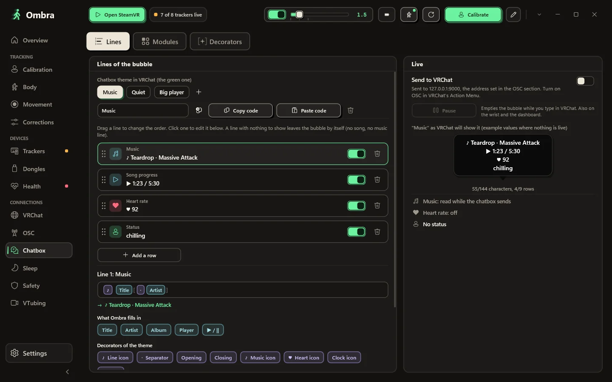
       <b>VRChat chatbox</b> 
      Your song, heart rate, status and the time, in a bubble drawn the way VRChat draws it. There are eight looks to start from, and a theme travels as a 9-character code like <code>T7RK-1J85-6</code>. Ombra sends only when the text changes.
    </td>
    <td width="50%" valign="top">
      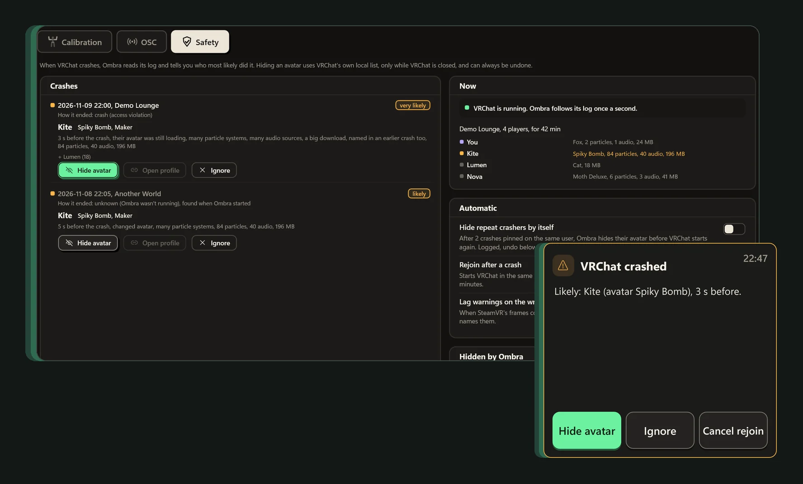
       <b>Crash reports</b> 
      After a VRChat crash, Ombra shows who loaded which avatar in the seconds before, and one click hides that avatar. It works from VRChat's log on your PC, so it needs no password and never touches the game.
    </td>
  </tr>
  <tr>
    <td width="50%" valign="top">
      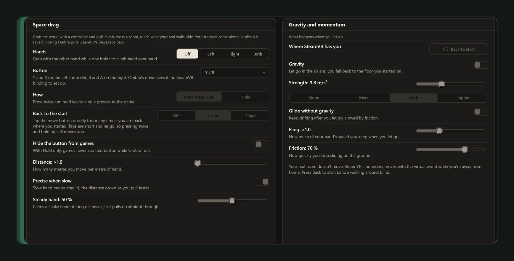
       <b>Space drag</b> 
      Hold a controller button and pull the world: climb, cross a big room, reach what your real walls hide. Let go and you keep the fling, with gravity from Moon to Jupiter if you want it. It works while a game has focus and needs no SteamVR binding. A double or triple tap on the same button brings you back to where you started.
    </td>
    <td width="50%" valign="top">
      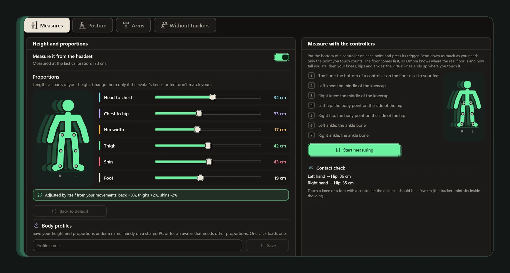
       <b>A full body from the headset, no trackers</b> 
      Hips, knees and feet are simulated from your headset and sent to SteamVR as trackers, so your avatar's legs stand, sit, lie down and walk with you. Pick a walk (natural, masculine, feminine, confident, shy) and a way to sit (relaxed, wide, composed, legs crossed). It is off until you turn it on, and it also fills in a leg that has no tracker.
    </td>
  </tr>
  <tr>
    <td width="50%" valign="top">
      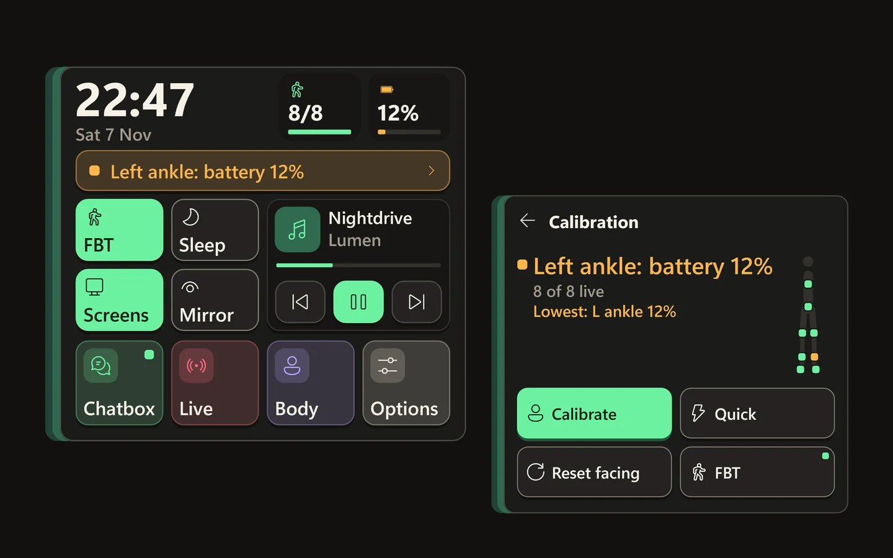
       <b>A panel on your wrist</b> 
      Look at your wrist and it fades in with the clock, your music and your PC's notifications. Chat from Twitch, YouTube and TikTok LIVE shows up on it too. With trackers it adds their batteries and the Calibrate button.
    </td>
    <td width="50%" valign="top">
      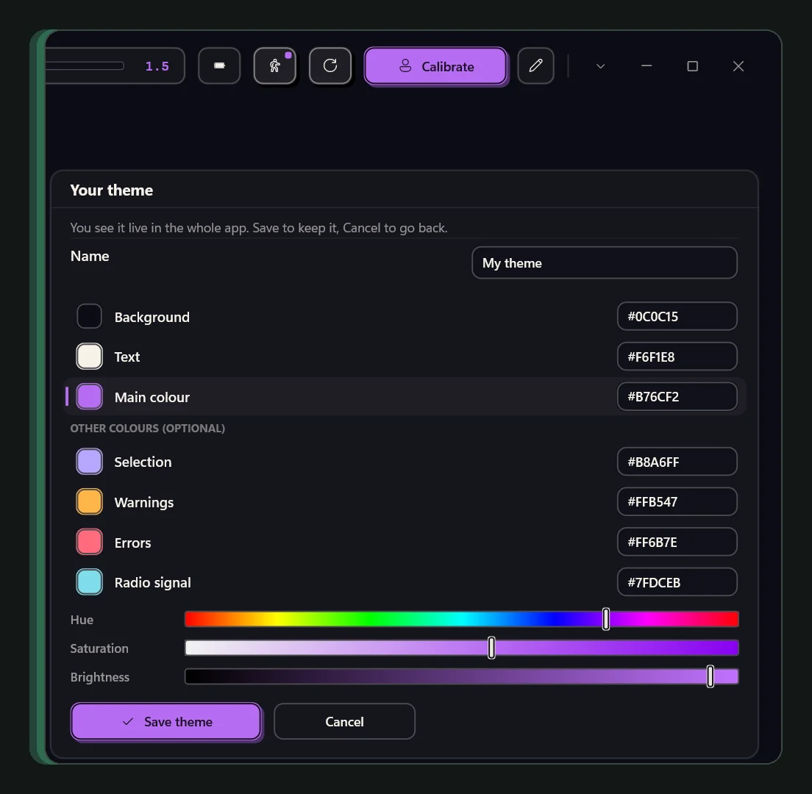
       <b>Your colours, your sidebar</b> 
      Twelve themes, or your own from three colours, shared as a code and applied to the panels in VR too. The sidebar is yours to arrange in folders, like on Discord.
    </td>
  </tr>
</table>

Also without trackers: a sleep mode that dims the headset, a pocket mirror that shows your body as a small figure next to you, and speech to chatbox that runs on your PC.

### With HaritoraX or SlimeVR-compatible trackers

<table>
  <tr>
    <td width="50%" valign="top">
      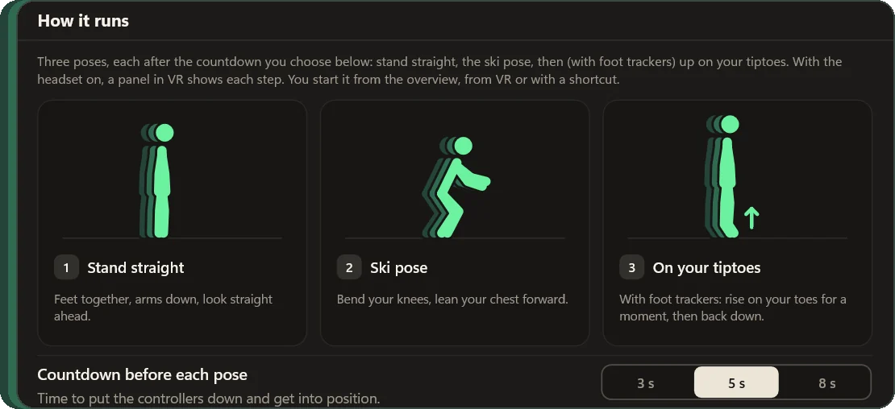
       <b>Full-body tracking</b> 
      Ombra reads HaritoraX 2, 2 Pro and Wireless through GX2 or GX6 dongles, and SlimeVR-compatible trackers over Wi-Fi or USB. You calibrate in two poses, three with foot trackers, and a quick calibration is enough on most days.
    </td>
    <td width="50%" valign="top">
      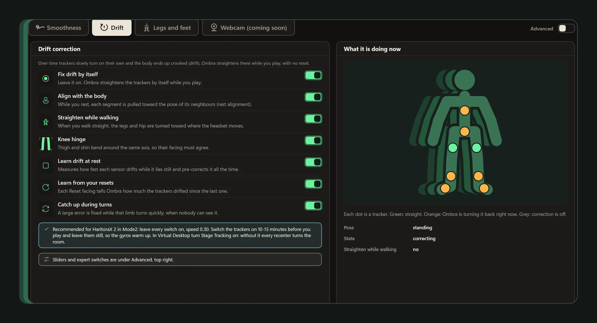
       <b>Drift correction</b> 
      Heading is corrected while you play, a few degrees per second at most. In a simulated 30-minute social session the median leg error goes from 36.5° to 7.1°. <a href="docs/how-it-works.md#drift-correction">How it was measured.</a>
    </td>
  </tr>
  <tr>
    <td width="50%" valign="top">
      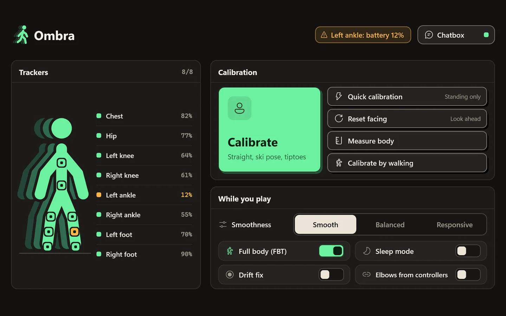
       <b>A tab in the SteamVR dashboard</b> 
      Every tracker with its battery, a tracker that is off in amber, and a big Calibrate button that turns into Cancel while you calibrate.
    </td>
    <td width="50%" valign="top">
      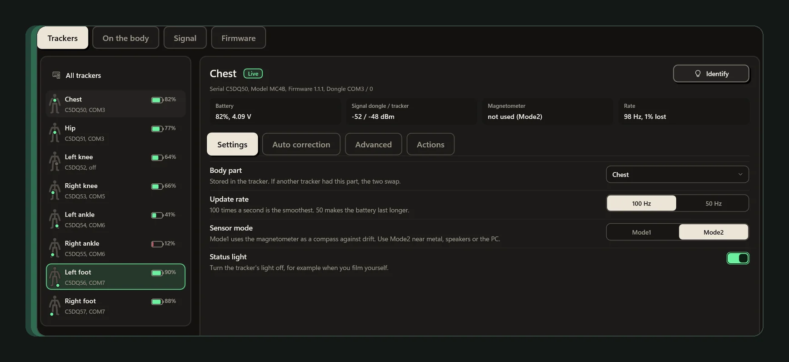
       <b>Every tracker setting</b> 
      Battery, signal, firmware, update rate, sensor mode and the status light, with pairing and firmware updates in the same window.
    </td>
  </tr>
</table>

There is more for trackers: elbows without elbow trackers, a body measured by touching your joints with a controller, smoothing per tracker, voice warnings, VRChat OSC and VMC output, and a Health page for stutters. The [full feature list](docs/features.md) has all of it, and the [website](https://thadoom.github.io/ombra/) shows it with pictures in 10 languages.

## Install

You need Windows 10 or 11 (64-bit) and SteamVR.

1. Download [`Ombra-Setup.exe`](https://github.com/thadoom/ombra/releases/latest/download/Ombra-Setup.exe).
2. Close SteamVR and any other tracker app. Only one app can use the dongles or receivers at a time.
3. Run the setup. It needs no admin rights and registers the SteamVR driver. If Windows says it protected your PC, click **More info**, then **Run anyway**: the installer isn't code-signed yet.
4. Turn on your trackers, start SteamVR (it starts Ombra for you) and press **Calibrate**.

Ombra tells you when a new version is out and installs it in one click, never while SteamVR is running. To remove it, go to Windows Settings → Apps → Ombra, and your SteamVR settings go back to how they were.

<b>Supported trackers</b>

 

| Trackers | Connection |
|---|---|
| HaritoraX 2, HaritoraX 2 Pro | GX2 or GX6 dongle |
| HaritoraX Wireless | GX2 or GX6 dongle |
| SlimeVR-compatible trackers: DIY boards, Butterfly, Smol Slime, other nRF trackers | Wi-Fi or a USB receiver |
| Any other IMU tracker already in SteamVR | Smoothing and prediction only, if you turn it on |
| No trackers | Choose *No trackers* in the setup: chatbox, VRChat tools and the body from the headset |

HaritoraX 1 and 1.1 (wired) are not supported yet. If you want another tracker, [propose it](https://github.com/thadoom/ombra/issues/new?template=feature_request.yml).

<b>Using Ombra without trackers</b>

 
Many people use Ombra for the chatbox, the VRChat tools and the body from the headset. Choose <i>No trackers</i> in the setup and Ombra never asks for a dongle. To look at the tracking side anyway, <code>Ombra.exe --demo</code> runs eight simulated trackers. The demo never touches COM ports, Bluetooth, SteamVR or your settings.

### Check the download

`Ombra-Setup.exe` comes from the [Releases page](https://github.com/thadoom/ombra/releases) of this repository. The website and the updater inside Ombra download the same file.

- GitHub shows the installer's SHA-256 next to the file on each release. To compare it with the file you have, run `Get-FileHash .\Ombra-Setup.exe` in PowerShell.
- Every release is scanned with Microsoft Defender on a GitHub runner and uploaded to VirusTotal. [Open the VirusTotal report for the latest installer.](https://thadoom.github.io/ombra/vt/)

The installer isn't code-signed yet. That is why SmartScreen warns, and why a couple of the 70-odd engines on VirusTotal can flag it with a generic machine-learning verdict; the report shows which ones. If the antivirus you use flags Ombra, [tell us](https://github.com/thadoom/ombra/issues/new?template=bug_report.yml). There is more in [SECURITY.md](SECURITY.md).

## Privacy

Ombra has no account, no ads and no analytics. Your settings, body measurements and calibration stay on your PC, in `%APPDATA%\Ombra`. It goes online only:

- to check for a new version, on GitHub (you can turn this off in Settings);
- for tracker and dongle firmware, from Shiftall's servers or the copy on this repository;
- for the speech model, from Hugging Face, only if you turn on speech to chatbox;
- to the services you connect yourself, like Pulsoid, Twitch or YouTube. TikTok LIVE is opened the way TikTok's website does it, and the connection is signed by Euler Stream, an independent service that sees which LIVE is read and your IP address, nothing else.

OSC and VMC go only to the address you set, your own PC by default. The [privacy page](https://thadoom.github.io/ombra/legal.html#privacy) has the details.

## How it works

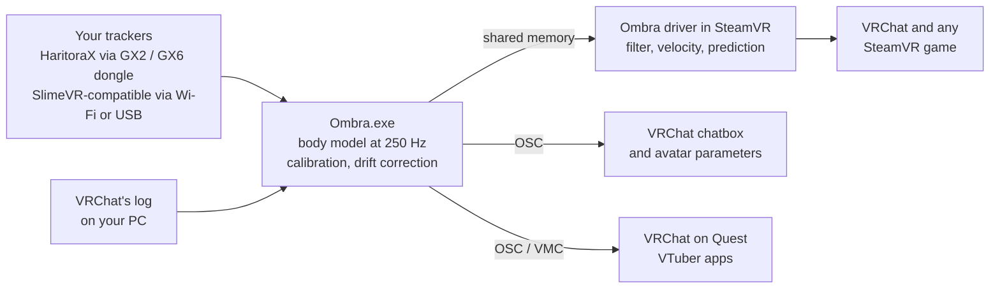

Ombra reads the trackers, builds your body 250 times a second and hands it to its own SteamVR driver. The driver filters each pose and adds velocity, so SteamVR can predict it to the frame. Headsets, controllers and base stations are never modified.

[How Ombra works](docs/how-it-works.md) covers the skeleton, calibration, missing sensors, elbows and drift correction, with the measured numbers.

## FAQ

<b>Do I need another app for my trackers?</b>

 
No. Ombra reads the dongles, pairs trackers and updates firmware by itself. Keep other tracker apps closed while Ombra runs.

<b>Does it work with a Quest?</b>

 
Yes. With a PC, through SteamVR, wired or wireless. With VRChat running on the Quest itself, Ombra sends your body over OSC from your PC, without SteamVR.

<b>Why does Windows warn me about the installer?</b>

 
The installer isn't code-signed yet, so SmartScreen doesn't recognise it. Click <b>More info</b>, then <b>Run anyway</b>. The setup installs into your user folder and needs no admin rights. To check the file first, see <a href="#check-the-download">Check the download</a>.

<b>Does it work with VRChat?</b>

 
Yes. Ombra confirms VRChat's calibration for you as soon as you stand still, and shows the best VRChat tracking settings for your set (Calibration → VRChat), with one-click apply and undo. It also drives your chatbox and shows who is in your instance.

<b>Can Ombra protect me from crashers?</b>

 
It helps after the fact. Ombra reads VRChat's log on your PC, so after a crash it shows who loaded an avatar in the seconds before, and hides that avatar for you in one click. It can't stop an attack while it happens, and it never touches the game itself.

<b>Is it safe for my trackers?</b>

 
Firmware updates use only Shiftall's original signed files, unmodified, checked with SHA-256 before use, and the trackers check the signature too. Tracker settings can always be reset to factory values.

<b>Why isn't the source code public?</b>

 
Ombra is free to download and use, but its code stays closed. You can still shape it by proposing features, extensions and translations.

<b>Something doesn't work. What should I send?</b>

 
Settings → <b>Export diagnostics</b> creates one text file with versions, trackers, calibration, settings and logs. Attach it to a <a href="https://github.com/thadoom/ombra/issues/new/choose">bug report</a>.

## Made with AI tools

Ombra is made by one developer working with AI tools, mainly Claude by Anthropic. Where they are used:

- For research: how the trackers, SteamVR and VRChat work, how other tracking apps approach the same problems, and papers on IMU tracking.
- For code: much of it is written, reviewed and tested with AI help. The developer decides what Ombra does and checks the result, and nothing is released without their approval.
- For translations: the nine languages besides English were translated with AI help. If something reads wrong in your language, [tell us](https://github.com/thadoom/ombra/issues/new?template=translation.yml).
- Not for images. The logo and the walking figure are drawn by code, and every screenshot is a real capture of the app.

The only AI inside the app is the optional speech to chatbox, which uses the Whisper model through whisper.cpp. It runs on your PC, and your voice never leaves it. The voice warnings in SteamVR use the voices built into Windows.

## Feedback

Ombra is closed source, but most of what it does started as someone's idea.

| What | Where |
|---|---|
| A new feature or extension: an output, a game integration, a tracker type, a calibration idea | [Open a proposal](https://github.com/thadoom/ombra/issues/new?template=feature_request.yml) |
| A new language, or a better translation | [Open a translation request](https://github.com/thadoom/ombra/issues/new?template=translation.yml) |
| Something that doesn't work | [Report a bug](https://github.com/thadoom/ombra/issues/new?template=bug_report.yml), with the diagnostics file |
| A question, or an idea to discuss first | [Discussions](https://github.com/thadoom/ombra/discussions) or [Discord](https://discord.gg/vFejerFCWA) |

Accepted proposals are built into Ombra and credited in the release notes. [CONTRIBUTING.md](CONTRIBUTING.md) explains how.

If Ombra worked with your trackers, a star helps other HaritoraX and SlimeVR users find it. A line in [Discussions](https://github.com/thadoom/ombra/discussions) about your set helps even more.

## License

Ombra is freeware: free to download, use and share through the official link, but not open source. See [LICENSE](LICENSE). Third-party components and their licenses are listed in [THIRD_PARTY_NOTICES.md](THIRD_PARTY_NOTICES.md).

HaritoraX, SteamVR, VRChat and SlimeVR are trademarks of their respective owners and are named only to describe compatibility.
