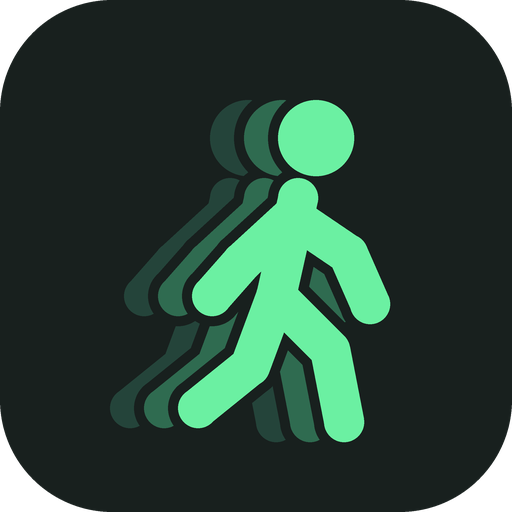

<p align="center">
  
</p>

<h1 align="center">Ombra</h1>

<p align="center">
  Smooth, precise full-body tracking for <b>HaritoraX 2 / 2 Pro</b> in SteamVR.<br>
  One small native app: dongles, body, calibration, drift correction and SteamVR driver.
</p>

<p align="center">
  <a href="https://github.com/thadoom/ombra/releases/latest"></a>
  <a href="LICENSE"></a>
  
  <a href="https://thadoom.github.io/ombra/"></a>
</p>

<p align="center">
  <a href="https://github.com/thadoom/ombra/releases/latest"><b>⬇ Download Ombra</b></a> ·
  <a href="#install">Install</a> ·
  <a href="#how-it-works">How it works</a> ·
  <a href="#how-ombra-estimates-your-body">How it estimates</a> ·
  <a href="#ombra-compared">Compared</a> ·
  <a href="#propose-a-feature-or-an-extension">Propose a feature</a>
</p>

<p align="center">
  
</p>

> Free to download and use. Closed source. Independent project, not affiliated with Shiftall, Valve, VRChat or SlimeVR.

## What Ombra does

Ombra reads your HaritoraX trackers **straight from the GX dongles**, rebuilds your body from the sensors and your headset, and gives SteamVR trackers that behave like Vive trackers: every pose carries its velocity, so SteamVR predicts it to the exact frame time.

- **Reads the dongles itself.** GX2 and GX6, 50 or 100 Hz per sensor. Pair, unpair, change radio channels and tracker settings inside the app.
- **Smooth without lag.** An adaptive filter that is steady when you stand still and fast when you kick, with latency compensation for the radio link.
- **Guided calibration in two poses**, about 6 seconds. It finds how each sensor is mounted and tells you which one to fix.
- **Quick calibration** most days: Ombra remembers how each sensor sits on your body, also after a restart, so you only stand straight.
- **Drift correction while you play**, built from many independent checks and tested on simulated 30-minute sessions (numbers [below](#drift-correction)).
- **Elbows without elbow trackers**, estimated from the controllers.
- **Leg corrections**: real floor, no foot sliding, natural knee limits, bed mode.
- **Ombra inside SteamVR**: a dashboard tab with every tracker, its battery and big buttons for calibrate, quick calibration and reset facing. Voice warnings when a tracker drops out or its battery runs low.
- **Firmware updates** for trackers (Bluetooth) and dongles (USB), with Shiftall's original signed files, checked before use.
- **More outputs**: VRChat OSC trackers (VRChat on a standalone Quest) and VMC for VTuber apps.
- **More trackers**: SlimeVR-compatible trackers over Wi-Fi or a USB receiver, with guided Wi-Fi setup.
- In **English, Italiano, Deutsch and Français**.

<table>
  <tr>
    <td></td>
    <td></td>
  </tr>
  <tr>
    <td></td>
    <td></td>
  </tr>
</table>

## Install

1. Download `Ombra-Setup.exe` from [Releases](https://github.com/thadoom/ombra/releases/latest).
2. Close Shiftall VR Manager and SteamVR. Only one app can use the dongles at a time.
3. Run the setup. It needs no admin rights and registers the SteamVR driver.
4. Turn on the trackers, start SteamVR (it starts Ombra for you) and press **Calibrate**.

**Requirements:** Windows 10 or 11 (64-bit), SteamVR, HaritoraX 2 or 2 Pro with a GX2 or GX6 dongle.

**Updates:** Ombra tells you when a new version is out and installs it in one click. It never updates while SteamVR is running.

**Try it without hardware:** `Ombra.exe --demo` runs eight simulated trackers. It never touches COM ports, Bluetooth, SteamVR or your settings.

**Uninstall:** Windows Settings → Apps → Ombra. Your SteamVR settings go back to how they were.

## How it works

```
GX dongles ──USB──▶ Ombra.exe ──shared memory──▶ Ombra driver (inside SteamVR) ──▶ your game
 sensors            body model at 250 Hz,         virtual trackers: hip, chest,
 50/100 Hz          calibration, drift,           knees, feet (+ elbows),
                    3D preview, settings          filter, velocity, prediction
```

1. **Dongles.** Ombra opens each GX dongle over USB and decodes every sensor's orientation, battery, signal and real update rate. Tracker settings you choose (rate, mode, light, ankle sensor) are written back each time a tracker connects.
2. **Body.** A core loop at 250 Hz turns the sensor rotations into a body (see [below](#how-ombra-estimates-your-body)) and writes the virtual trackers into shared memory.
3. **Driver.** Ombra's SteamVR driver creates the trackers with their roles already set (waist, chest, knees, feet), then for every pose:
   - filters it with an adaptive One Euro filter (presets Smooth, Balanced, Responsive, Off, a 0–10 slider, and a separate style per tracker);
   - adds linear and angular velocity, faded to zero when you stand still, so SteamVR predicts the pose to the frame;
   - shifts the pose time by the radio latency (12 ms by default, adjustable).
4. **Nothing else is touched.** Headsets, controllers and base stations are never modified. Filtering other IMU trackers already in SteamVR is optional and off by default.

The filter was tuned on a benchmark that models VRChat at 90 Hz with its own motion prediction, so the defaults are picked for how the trackers look in-game, not on a graph.

## How Ombra estimates your body

IMU trackers only measure rotation. Everything about *where* your body is comes from a model. This is how Ombra builds it.

### 1. The skeleton

- **Your height** comes from your headset: standing eye height ÷ 0.936. You can also type it or **measure your body with the controllers**: touch your knees, hip bones and ankles with the bottom of a controller and Ombra measures each segment (left/right touches that disagree by more than 6 cm are rejected).
- **Segment lengths** are anatomical proportions of your height (for example thigh 24.5 %, shin 24.6 %, chest to hip 19 %).
- **Forward kinematics from the headset down:** eyes → neck → chest → spine → hip → knees → ankles → feet. Each bone takes its rotation from its sensor, so the headset's real position anchors the whole body.

### 2. Calibration: how each sensor is worn

A sensor is never perfectly straight on your leg. Calibration measures that offset.

- **Standing:** gravity gives each sensor's "up", the headset gives "forward".
- **Ski pose** (knees bent forward): each segment bends around a known axis, and the axis the sensor sees reveals how it is turned on the limb. Sensors that bend too little borrow the average of the same kind; one that is twisted, moving or missing is named on screen.
- **Quick calibration** reuses the mounting stored per tracker, so a standing pose is enough until you move a strap.
- Start it from the app, from the SteamVR dashboard, with a **T-pose**, a **double press of the triggers** with the controllers down, by **tapping a tracker** (2 taps reset facing, 3 taps quick calibration) or with **Ctrl+Alt+Shift+Y / U / I**.

### 3. What Ombra estimates when a sensor is missing

| Missing | Estimate |
|---|---|
| Hip sensor | follows the chest |
| Chest sensor | halfway between the hip and where your head faces |
| Thigh or shin | each copies the other |
| Foot sensor | follows the shin's heading |
| A sensor drops out | its last pose is held relative to its parent for a moment, then blended into the estimate (1 s hysteresis, so a flickering signal doesn't jump) |

### 4. Elbows from the controllers

- The elbow must lie on a circle: one upper-arm length from the shoulder and one forearm length from the hand. Arm lengths come from your height.
- **Without arm trackers**, the point on that circle comes from how you hold the controller (thumb up: elbow down; palm down: elbow out), blended with a natural rest pose and smoothed over about 60 ms. The shoulder rises a little when the hand goes overhead and comes forward when you reach.
- **With a sensor on the upper arm**, Ombra uses only its tilt, which gravity keeps exact. Drift of the sensor's heading doesn't move the elbow: in tests, 25° of drift gives under 3 cm of elbow error.

### Drift correction

IMU sensors slowly lose their heading (yaw). Ombra never touches tilt, which gravity keeps correct, and corrects heading only, with many small checks that each move a sensor by at most a few degrees per second:

- **Head anchor:** over a minute, your chest and hips face where your head faces on average.
- **Turn matching:** every 120° you turn, the headset's turn is compared with each sensor's turn. This measures the gyro's scale error and drift rate and corrects them.
- **Learning drift rates:** how fast each sensor drifts at rest, and how much it had drifted every time you reset facing. Saved per tracker, so it starts corrected next time.
- **Rest alignment:** when you stand still, each segment is pulled toward its neighbours.
- **Walking:** while you walk, legs are aligned with the direction you walk.
- **Anatomy:** a foot can't point 20° away from its shin, a thigh can't point 35° away from the hips while standing; the knee is a hinge.
- **Lying down:** on your back, the chest and hip mounting are corrected from gravity, and drift while lying is cancelled from its trend.
- **Fast catch-up:** a large error is fixed while that limb turns quickly, when you can't see it happen.
- **Magnetometer mode** (Mode 1): a magnetic map of your room, so metal and speakers don't pull the compass.
- Every correction freezes while you turn fast, and the total is capped.

**Measured** on simulated 30-minute sessions with HaritoraX 2 noise (median leg heading error / 95th percentile):

| Session | Without correction | With Ombra |
|---|---|---|
| Social (standing, walking, talking) | 36.5° | 7.1° / 14.5° |
| Dance | 76.2° | 15.3° / 39.4° |
| Seated | 6.5° | 6.0° / 12.7° |

In the social session, the time spent more than 10° off drops from 31.9 % to 13.6 %. Hardest cases today: long dances on cheap IMUs and lying in bed.

## Ombra compared

Ombra was built by studying how **Shiftall VR Manager** talks to the trackers and how **SlimeVR Server** approaches IMU body tracking. It is a separate program with its own design.

| | Ombra | Shiftall VR Manager | SlimeVR Server |
|---|---|---|---|
| Reads HaritoraX GX dongles | ✅ directly | ✅ directly | needs a separate bridge app |
| App | one native app, no browser engine | Flutter app | Java server + Electron window |
| Velocity + latency compensation to SteamVR | ✅ | – | – |
| Quick calibration that survives a restart | ✅ per tracker | – | – |
| Elbows from controllers (no arm trackers) | ✅ | – | – |
| Body measured by touching joints | ✅ | – | – |
| Drift: head anchor, turn matching, learned rates, anatomy, lying fix | ✅ | partial | rest alignment |
| All tracker settings (incl. light off) | ✅ | some hidden | n/a |
| SteamVR dashboard tab + voice warnings | ✅ | – | – |
| Firmware updates | ✅ | ✅ | for its own trackers |
| VRChat OSC / VMC output | ✅ | – | ✅ |
| Automatic body proportions, recording | – | – | ✅ |

"–" means we found no such feature. If something in this table is wrong or out of date, please [open an issue](https://github.com/thadoom/ombra/issues/new/choose) and it will be fixed.

**In short:**
- **Versus VR Manager:** the same hardware access, plus Ombra's filter with SteamVR prediction, a deeper drift correction, persistent quick calibration, estimated elbows, in-VR controls and more outputs, in one lighter app.
- **Versus SlimeVR Server:** native HaritoraX support without a bridge, a single native app instead of a server and a browser window, and drift correction that goes beyond rest alignment. SlimeVR still has things Ombra doesn't, like automatic body proportions and motion recording.

## FAQ

<details>
<summary>Do I still need Shiftall VR Manager?</summary>
No. Ombra reads the dongles, pairs trackers and updates firmware by itself. Just keep VR Manager closed while Ombra runs.
</details>

<details>
<summary>Does it work with VRChat?</summary>
Yes. Ombra can confirm VRChat's calibration for you as soon as you stand still, and it shows the best VRChat tracking settings for your set (Calibration → VRChat), with one-click apply and undo.
</details>

<details>
<summary>Is it safe for my trackers?</summary>
Firmware updates use only Shiftall's original signed files, unmodified, checked by SHA-256 before use; the trackers check the signature too. Tracker settings can always be reset to factory values.
</details>

<details>
<summary>Why isn't the source code public?</summary>
Ombra is free to download and use, but its code stays closed. You can still shape it: propose features, extensions and translations (see below).
</details>

<details>
<summary>Something doesn't work. What should I send?</summary>
Settings → <b>Export diagnostics</b> creates one text file with versions, trackers, calibration, settings and logs. Attach it to a <a href="https://github.com/thadoom/ombra/issues/new/choose">bug report</a>.
</details>

## Propose a feature or an extension

Ombra is closed source, but it is built with its users.

- 💡 **New feature or extension** (a new output, a game integration, a new tracker type, a calibration idea): [open a proposal](https://github.com/thadoom/ombra/issues/new?template=feature_request.yml).
- 🌍 **Translation** (a new language or a fix): [open a translation request](https://github.com/thadoom/ombra/issues/new?template=translation.yml).
- 🐞 **Bug**: [report it](https://github.com/thadoom/ombra/issues/new?template=bug_report.yml) with the diagnostics file.
- 💬 **Questions and ideas**: [Discussions](https://github.com/thadoom/ombra/discussions).

Accepted proposals are built into Ombra and credited in the release notes. See [CONTRIBUTING.md](CONTRIBUTING.md).

## License

Ombra is **freeware**: free to download, use and share through the official link, but not open source. See [LICENSE](LICENSE). Third-party components and their licenses: [THIRD_PARTY_NOTICES.md](THIRD_PARTY_NOTICES.md).

HaritoraX, SteamVR, VRChat and SlimeVR are trademarks of their respective owners and are named only to describe compatibility.
