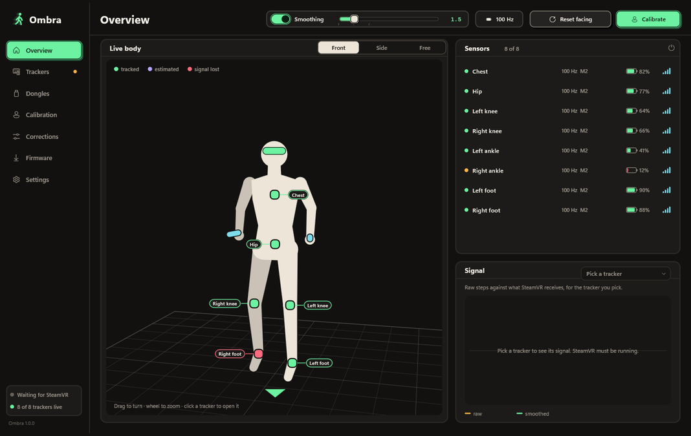
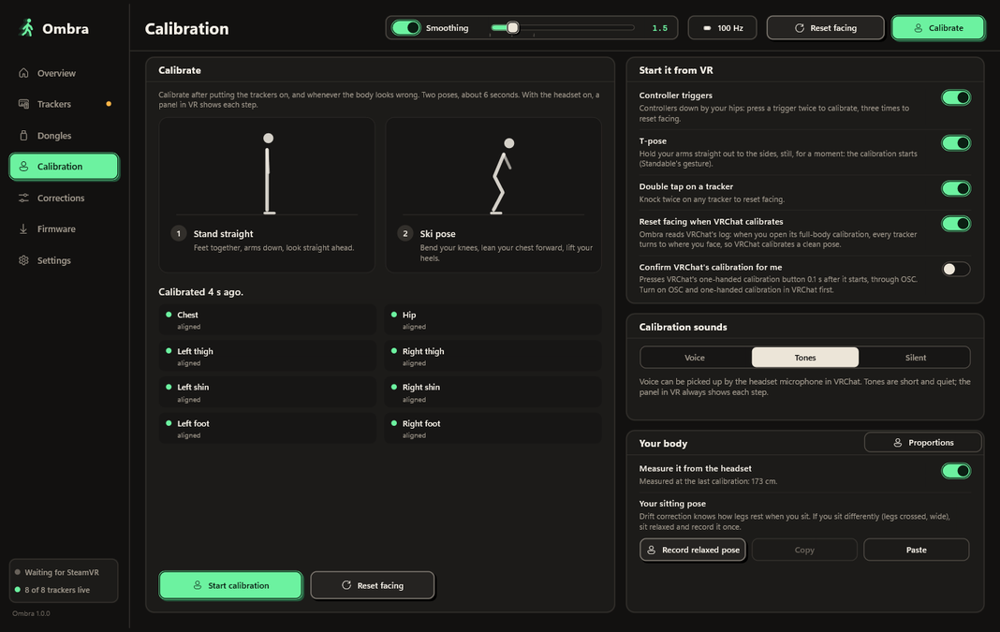
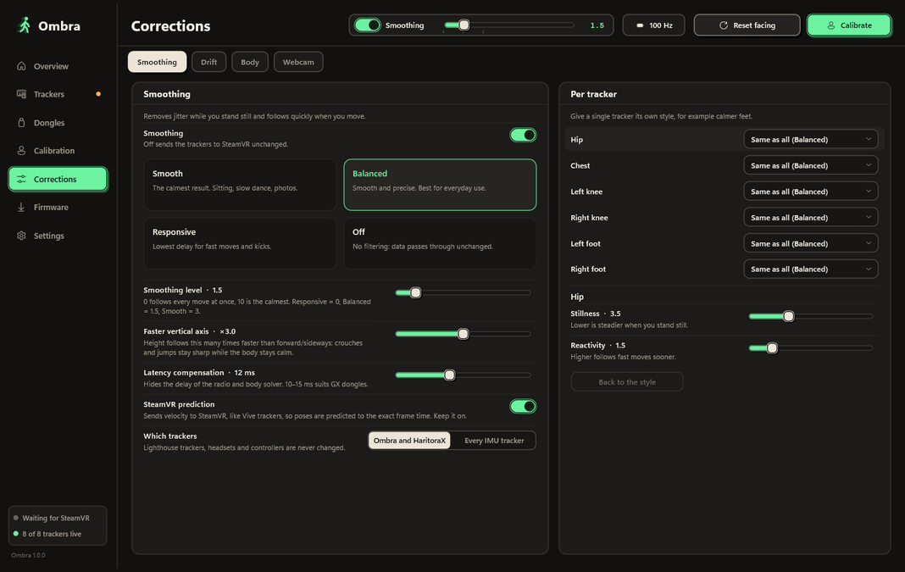
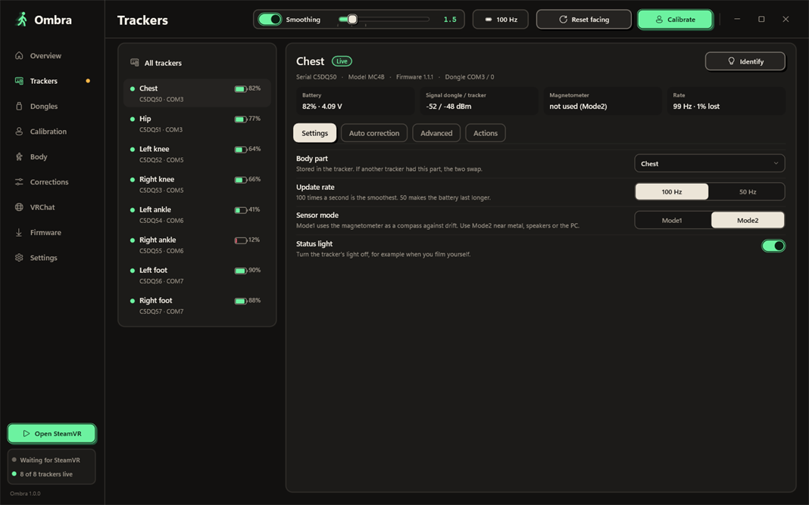
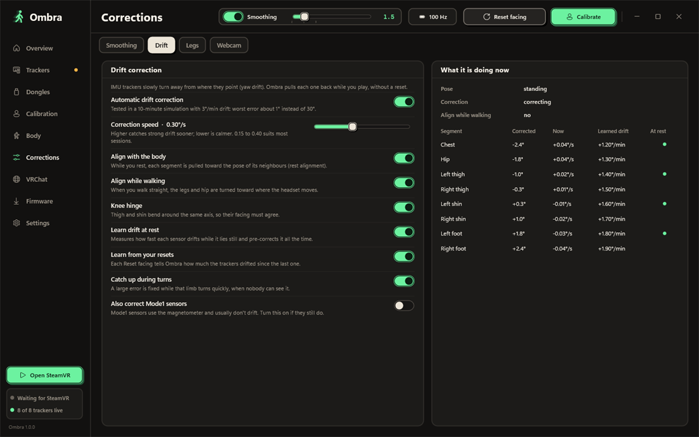

<p align="center">
  
</p>

<p align="center">
  A free Windows app that runs your HaritoraX and SlimeVR-compatible trackers in SteamVR on its own.<br>
  It reads the dongles, builds your body from the sensors and your headset, and keeps every tracker steady, quick and free of drift.
</p>

<p align="center">
  <a href="https://github.com/thadoom/ombra/releases/latest/download/Ombra-Setup.exe"></a>
  &nbsp;
  <a href="https://thadoom.github.io/ombra/"></a>
</p>

<p align="center">
  <sub>The button always downloads the latest <code>Ombra-Setup.exe</code>. Windows 10 and 11, 64-bit, no admin rights.<br>
  If Ombra works well for you, a star (top right) helps other people find it.</sub>
</p>

<p align="center">
  
</p>

Ombra is Italian for shadow. It is an independent project, free to download and use, with closed source code. It is not affiliated with Shiftall, Valve, VRChat or SlimeVR.

## What it does

- **Reads your trackers directly.** HaritoraX 2, 2 Pro and Wireless through GX2 or GX6 dongles, at 50 or 100 Hz per sensor, with pairing and tracker settings in the app. SlimeVR-compatible trackers over Wi-Fi or a USB receiver. VR Manager and SlimeVR Server can stay closed.
- **Smooth without lag.** An adaptive filter that is steady when you stand still and quick when you kick, with compensation for the radio delay. Every pose carries its velocity, so SteamVR predicts it to the frame, like a Vive tracker.
- **Calibration in two poses**, about six seconds. Ombra works out how each sensor sits on your limb and names the one to fix. On most days a quick calibration is enough: Ombra remembers each mounting, even after a restart.
- **Drift correction while you play**, built from many small, independent checks. [How it works, with numbers.](#drift-correction)
- **Elbows without elbow trackers**, estimated from how you hold the controllers.
- **Believable legs:** a real floor, planted feet that don't slide, natural knee limits, and a bed mode.
- **Inside SteamVR:** a dashboard tab with every tracker and its battery, big buttons for calibrate and reset facing, and voice warnings when a tracker drops out or runs low.
- **Firmware updates** for trackers (Bluetooth) and dongles (USB), with Shiftall's original signed files, checked before use.
- **More outputs:** VRChat OSC trackers, for VRChat on a standalone Quest, and VMC for VTuber apps.
- **Mixed sets:** HaritoraX and SlimeVR-compatible trackers on one body, with a guided Wi-Fi setup for new SlimeVR boards.
- In English, Italiano, Deutsch and Français.

<table>
  <tr>
    <td width="50%"><br><sub>Calibration</sub></td>
    <td width="50%"><br><sub>Smoothing</sub></td>
  </tr>
  <tr>
    <td width="50%"><br><sub>Tracker details</sub></td>
    <td width="50%"><br><sub>Drift correction</sub></td>
  </tr>
</table>

## Install

1. **Download** [`Ombra-Setup.exe`](https://github.com/thadoom/ombra/releases/latest/download/Ombra-Setup.exe).
2. **Close** SteamVR and any other tracker app, such as Shiftall VR Manager or SlimeVR Server. Only one app can use the dongles or receivers at a time.
3. **Run the setup.** It needs no admin rights and registers the SteamVR driver. If Windows says it protected your PC, click **More info**, then **Run anyway**: the installer isn't code-signed yet.
4. **Turn on your trackers**, start SteamVR (it starts Ombra for you) and press **Calibrate**.

You need Windows 10 or 11 (64-bit) and SteamVR.

| Trackers | Connection |
|---|---|
| HaritoraX 2, HaritoraX 2 Pro | GX2 or GX6 dongle |
| HaritoraX Wireless | GX2 or GX6 dongle |
| SlimeVR-compatible trackers: DIY boards, Butterfly, Smol Slime, other nRF trackers | Wi-Fi or a USB receiver |
| Any other IMU tracker already in SteamVR | Smoothing and prediction only, if you turn it on |

HaritoraX 1 and 1.1 (wired) are not supported yet. Want another tracker? [Propose it](https://github.com/thadoom/ombra/issues/new?template=feature_request.yml).

**Updates.** Ombra tells you when a new version is out and installs it in one click. It never updates while SteamVR is running.

**Try it without trackers.** `Ombra.exe --demo` runs eight simulated trackers. The demo never touches COM ports, Bluetooth, SteamVR or your settings.

**Uninstall.** Windows Settings → Apps → Ombra. Your SteamVR settings go back to how they were.

## How it works

```
Trackers ─────────▶ Ombra.exe ─────shared memory────▶ Ombra driver (in SteamVR) ──▶ your game
GX dongles,         body model at 250 Hz,             virtual trackers: hip, chest,
Wi-Fi, receivers    calibration, drift,               knees, feet (+ elbows),
                    3D preview, settings              filter, velocity, prediction
```

1. **Trackers.** Ombra opens each GX dongle over USB, or receives SlimeVR-compatible trackers over Wi-Fi or a USB receiver, and decodes every sensor's orientation, battery, signal and real update rate. The tracker settings you choose (rate, mode, light, ankle sensor) are written back each time a tracker connects.
2. **Body.** A core loop at 250 Hz turns the sensor rotations into a body ([below](#how-ombra-estimates-your-body)) and writes the virtual trackers into shared memory.
3. **Driver.** Ombra's SteamVR driver creates the trackers with their roles already set (waist, chest, knees, feet). For every pose it:
   - filters it with an adaptive One Euro filter: presets Smooth, Balanced, Responsive and Off, a 0 to 10 slider, and a separate style per tracker;
   - adds linear and angular velocity, faded to zero when you stand still, so SteamVR predicts the pose to the frame;
   - shifts the pose time by the radio latency, 12 ms by default and adjustable.
4. **Nothing else is touched.** Headsets, controllers and base stations are never modified. Filtering other IMU trackers already in SteamVR is optional and off by default.

The filter was tuned on a benchmark that models VRChat at 90 Hz with its own motion prediction, so the defaults are chosen for how trackers look in the game, not on a graph.

## How Ombra estimates your body

IMU trackers only measure rotation. Everything about *where* your body is comes from a model. This is how Ombra builds it.

### The skeleton

- **Your height** comes from your headset: standing eye height ÷ 0.936. You can also type it, or **measure your body with the controllers**: touch your knees, hip bones and ankles with the bottom of a controller and Ombra measures each segment. Left and right touches that disagree by more than 6 cm are rejected.
- **Segment lengths** are anatomical proportions of your height, for example thigh 24.5 %, shin 24.6 %, chest to hip 19 %.
- **Forward kinematics from the headset down:** eyes, neck, chest, spine, hip, knees, ankles, feet. Each bone takes its rotation from its sensor, so the headset's real position anchors the whole body.

### Calibration: how each sensor is worn

A sensor is never perfectly straight on your leg. Calibration measures that offset.

- **Standing:** gravity gives each sensor's "up", and the headset gives "forward".
- **Ski pose**, knees bent forward: each segment bends around a known axis, and the axis the sensor sees shows how it is turned on the limb. Sensors that bend too little borrow the average of the same kind; one that is twisted, moving or missing is named on screen.
- **Quick calibration** reuses the mounting stored for each tracker, so standing straight is enough until you move a strap.
- **Start it** from the app, from the SteamVR dashboard, with a double press of the triggers (controllers down) or with **Ctrl+Alt+Shift+Y / U / I**. A T-pose, or taps on a tracker (2 taps reset facing, 3 taps run a quick calibration), can start it too; you can switch these gestures on or off on the Calibration page.

### When a sensor is missing

| Missing | Estimate |
|---|---|
| Hip sensor | Follows the chest |
| Chest sensor | Halfway between the hip and where your head faces |
| Thigh or shin | Each copies the other |
| Foot sensor | Follows the shin's heading |
| A sensor drops out | Its last pose is held relative to its parent for a moment, then blended into the estimate (1 s hysteresis, so a flickering signal doesn't jump) |

### Elbows from the controllers

- The elbow lies on a circle: one upper-arm length from the shoulder and one forearm length from the hand. Arm lengths come from your height.
- **Without arm trackers**, the point on that circle comes from how you hold the controller (thumb up: elbow down; palm down: elbow out), blended with a natural rest pose and smoothed over about 60 ms. The shoulder rises a little when the hand goes overhead and comes forward when you reach.
- **With a sensor on the upper arm**, Ombra uses only its tilt, which gravity keeps exact. Drift in the sensor's heading doesn't move the elbow: in tests, 25° of drift gives under 3 cm of elbow error.

### Drift correction

IMU sensors slowly lose their heading (yaw). Ombra never touches tilt, which gravity keeps correct. It corrects heading only, with many small checks that each move a sensor by at most a few degrees per second:

- **Head anchor:** over a minute, your chest and hips face where your head faces, on average.
- **Turn matching:** every 120° you turn, the headset's turn is compared with each sensor's turn. This measures the gyro's scale error and drift rate, and corrects both.
- **Learned drift rates:** how fast each sensor drifts at rest, and how far it had drifted each time you reset facing. Saved per tracker, so it starts corrected next time.
- **Rest alignment:** when you stand still, each segment is pulled toward its neighbours.
- **Walking:** while you walk, the legs are aligned with the direction you walk in.
- **Anatomy:** a foot can't point 20° away from its shin, a thigh can't point 35° away from the hips while standing, and the knee is a hinge.
- **Lying down:** on your back, the chest and hip mounting are corrected from gravity, and drift while lying is cancelled from its trend.
- **Fast catch-up:** a large error is fixed while that limb turns quickly, when you can't see it happen.
- **Magnetometer mode** (Mode 1): a magnetic map of your room, so metal and speakers don't pull the compass.
- Every correction freezes while you turn fast, and the total is capped.

Measured on simulated 30-minute sessions with HaritoraX 2 noise, as median leg heading error and 95th percentile:

| Session | Without correction | With Ombra |
|---|---|---|
| Social: standing, walking, talking | 36.5° | 7.1° / 14.5° |
| Dance | 76.2° | 15.3° / 39.4° |
| Seated | 6.5° | 6.0° / 12.7° |

In the social session, the time spent more than 10° off drops from 31.9 % to 13.6 %. The hardest cases today are long dances on cheap IMUs and lying in bed.

## Ombra compared

Ombra was built by studying how Shiftall VR Manager talks to the trackers and how SlimeVR Server approaches IMU body tracking. It is a separate program with its own design.

| | Ombra | Shiftall VR Manager | SlimeVR Server |
|---|---|---|---|
| Reads HaritoraX GX dongles | Yes, directly | Yes, directly | Through a separate bridge app |
| App | One native app, no browser engine | Flutter app | Java server and an Electron window |
| Velocity and latency compensation sent to SteamVR | Yes | – | – |
| Quick calibration that survives a restart | Yes, per tracker | – | – |
| Elbows from the controllers, without arm trackers | Yes | – | – |
| Body measured by touching joints | Yes | – | – |
| Drift correction | Head anchor, turn matching, learned rates, anatomy, lying fix | Partial | Rest alignment |
| All tracker settings, light off included | Yes | Some hidden | n/a |
| SteamVR dashboard tab and voice warnings | Yes | – | – |
| Firmware updates | Yes | Yes | For its own trackers |
| VRChat OSC and VMC output | Yes | – | Yes |
| Automatic body proportions, motion recording | – | – | Yes |

"–" means we found no such feature. If something here is wrong or out of date, [open an issue](https://github.com/thadoom/ombra/issues/new/choose) and it will be fixed.

Compared with VR Manager, Ombra has the same hardware access, plus its filter with SteamVR prediction, deeper drift correction, a quick calibration that persists, estimated elbows, controls inside VR and more outputs, in one lighter app. Compared with SlimeVR Server, it reads HaritoraX natively without a bridge and runs as a single native app instead of a server and a browser window, with drift correction that goes beyond rest alignment. SlimeVR still does things Ombra doesn't, such as automatic body proportions and motion recording.

## FAQ

<details>
<summary><b>Do I still need Shiftall VR Manager?</b></summary>
<br>
No. Ombra reads the dongles, pairs trackers and updates firmware by itself. Keep VR Manager closed while Ombra runs.
</details>

<details>
<summary><b>Why does Windows warn me about the installer?</b></summary>
<br>
The installer isn't code-signed yet, so SmartScreen doesn't recognise it. Click <b>More info</b>, then <b>Run anyway</b>. The setup installs into your user folder and needs no admin rights.
</details>

<details>
<summary><b>Does it work with VRChat?</b></summary>
<br>
Yes. Ombra can confirm VRChat's calibration for you as soon as you stand still, and it shows the best VRChat tracking settings for your set (Calibration → VRChat), with one-click apply and undo.
</details>

<details>
<summary><b>Is it safe for my trackers?</b></summary>
<br>
Firmware updates use only Shiftall's original signed files, unmodified, checked with SHA-256 before use, and the trackers check the signature too. Tracker settings can always be reset to factory values.
</details>

<details>
<summary><b>Why isn't the source code public?</b></summary>
<br>
Ombra is free to download and use, but its code stays closed. You can still shape it by proposing features, extensions and translations.
</details>

<details>
<summary><b>Something doesn't work. What should I send?</b></summary>
<br>
Settings → <b>Export diagnostics</b> creates one text file with versions, trackers, calibration, settings and logs. Attach it to a <a href="https://github.com/thadoom/ombra/issues/new/choose">bug report</a>.
</details>

## Propose a feature or an extension

Ombra is closed source, but it is built with the people who use it.

| What | Where |
|---|---|
| A new feature or extension: an output, a game integration, a tracker type, a calibration idea | [Open a proposal](https://github.com/thadoom/ombra/issues/new?template=feature_request.yml) |
| A new language, or a better translation | [Open a translation request](https://github.com/thadoom/ombra/issues/new?template=translation.yml) |
| Something that doesn't work | [Report a bug](https://github.com/thadoom/ombra/issues/new?template=bug_report.yml), with the diagnostics file |
| A question, or an idea to discuss first | [Discussions](https://github.com/thadoom/ombra/discussions) |

Accepted proposals are built into Ombra and credited in the release notes. See [CONTRIBUTING.md](CONTRIBUTING.md).

## License

Ombra is freeware: free to download, use and share through the official link, but not open source. See [LICENSE](LICENSE). Third-party components and their licenses are listed in [THIRD_PARTY_NOTICES.md](THIRD_PARTY_NOTICES.md).

HaritoraX, SteamVR, VRChat and SlimeVR are trademarks of their respective owners and are named only to describe compatibility.
